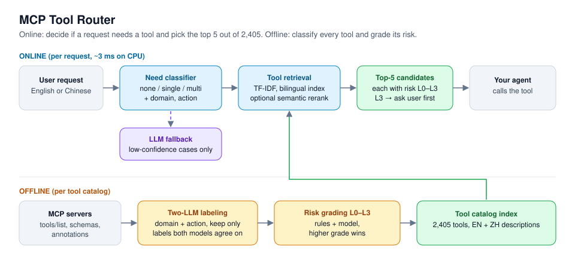

# MCP Tool Router

**A lightweight router for LLM agents. In about 3 ms on a CPU it decides whether a request needs a tool, picks the 5 most likely MCP tools out of 2,405, and flags risky tools that need the user's confirmation.**



## What it does

Agents that connect to many MCP servers get slow and make mistakes when every tool schema goes into the prompt. This router runs before the LLM and narrows the choice.

**Online, per request:**

- **Need classifier.** Does this request need a tool at all (`none` / `single` / `multi`)? It also predicts the capability domain (14 domains) and the action type.
- **Tool retrieval.** Returns the top 5 tools from the catalog. Requests can be in English or Chinese, because the index holds descriptions in both languages.
- **Soft need.** If the router says "no tool" but is not confident, it still attaches candidates and marks them as optional, so the downstream agent makes the final call.
- **LLM fallback.** Low-confidence requests (about 17% on the gold set) can go to a cloud LLM classifier. If that call times out, the router keeps its local answer and never throws.
- **Risk gate.** Every candidate carries a risk level from L0 to L3. L3 tools (for example payments or shell commands) set `requires_confirmation: true`.

**Offline, per tool catalog:**

- Pulls tool definitions from MCP servers (`tools/list`).
- Labels each tool's domain and action with two different LLMs and keeps only the labels both agree on.
- Grades risk with schema and name rules plus a model, and takes the **higher** of the two grades. Server authors write their own annotations, which may be missing or understated, so a parameter like `amount`, `payee` or `command` makes a tool L3 regardless of its annotations.

Example output for a Chinese request meaning "Book me a train ticket to Shanghai for tomorrow" (real output, cut to one candidate):

```json
{
  "text": "帮我订一张明天去上海的火车票",
  "need": "single",
  "candidates": [
    {"tool_id": "Trains/Trains_1_GetTrainTickets#7", "score": 0.1348, "risk": "L3"}
  ],
  "requires_confirmation": true,
  "latency_ms": 9.9
}
```

## Results

Evaluated on 600 real requests from the Berkeley Function-Calling Leaderboard (BFCL) against a catalog of 2,405 real tools. The data is split into a dev fold and a held-out test fold, and both are reported. All numbers come from [`reports/`](reports/), mainly [eval_current_default.md](reports/eval_current_default.md) and [eval_reference.md](reports/eval_reference.md).

| Metric (default config, end to end) | Dev | Test |
| --- | --- | --- |
| Correct tool in top 5, English requests (strict Recall@5) | **63.8%** | **57.2%** |
| Correct tool in top 5, Chinese requests (strict Recall@5) | 37.5% | 32.0% |
| Latency p50 / p95 (CPU, no GPU) | **2.5 ms / 3.4 ms** | |

| Other checks | Result |
| --- | --- |
| "Needs a tool" precision / recall (200-request reference set) | **94.9%** / 75.5% |
| High-risk (L3) tools graded too low, out of 28 in the reference set | **0** by the risk model, 2 by the rules alone |
| Bilingual index: Chinese Recall@5 before → after | 10.2% → 48.4% (measured at that stage) |
| Optional semantic reranker (bge-m3), test fold | Chinese 31.5% → 39.1%, English 55.6% → 59.5%, about 150 ms p95 |
| Optional light reranker (multilingual-e5-small), test fold | Chinese 37.8%, English 58.8%, about 20 ms p95 |

The [project summary](reports/项目总结.md) (in Chinese) lists the known weak spots: Chinese retrieval with plain TF-IDF, and domain accuracy of about 40% (domain is an output field only and does not affect retrieval). It also lists eight approaches that were tested and rejected, each with its own report.

## Tech stack

- **Python** 3.10+, NumPy, SciPy, scikit-learn (TF-IDF encoders, classification heads)
- **Optional:** sentence-transformers / PyTorch (bge-m3, multilingual-e5) for semantic reranking
- **MCP** client for pulling `tools/list` from servers
- **LLM labeling and fallback:** Anthropic SDK and OpenRouter, with an answer cache so re-runs make no API calls
- **Evaluation:** 5-fold cross-validation, held-out test fold, frozen probe set, two-model agreement labels, pytest

## How to run it

The default setup needs no GPU, no model download and no API key.

```bash
git clone https://github.com/hkban99668-code/mcp-tool-router.git
cd mcp-tool-router
pip install -r requirements.txt

python -m mcpcls.cli train          # builds the router on the real 2,405-tool catalog -> models/
python -m mcpcls.cli route "Book me a train ticket to Shanghai for tomorrow"
python -m pytest
```

Optional semantic reranking (installs PyTorch and downloads a model on first use):

```bash
pip install -r requirements-st.txt
python -m mcpcls.cli train --rerank intfloat/multilingual-e5-small --rerank-n 50 --rerank-fusion linear --rerank-alpha 0.3
```

Full technical documentation, including the experiment log, is in [README.zh-CN.md](README.zh-CN.md). It and the detailed reports in `reports/` are written in Chinese.

## License

No license file yet. Contact the author before reusing the code.
